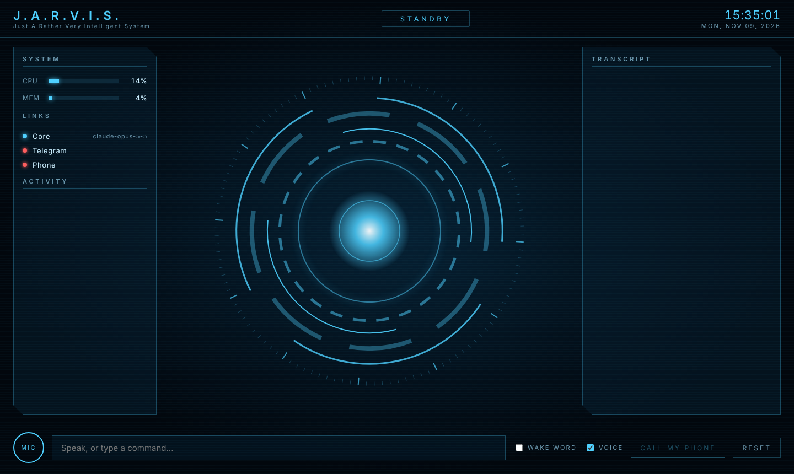

# J.A.R.V.I.S.

A home-PC assistant run by Claude, with a movie-style HUD, a voice, and a line to your phone.



| You want | How it works | Cost |
|---|---|---|
| Talk to it at the PC | Browser HUD (Chrome/Edge): push-to-talk or "Jarvis, ..." wake word, spoken replies | Free |
| Chat from your phone | Telegram bot, long polling, no ports opened | Free |
| Have it **call you** | Twilio voice call to your cell; you talk, it answers | Twilio number + per-minute |
| Brain | Claude (`claude-opus-5-5`) via the Anthropic API, with tools | Pay per use |

One shared conversation runs across all three channels, so what you tell it on the phone is
remembered at the desk.

## What it can do (tools)

- `web_search`, `web_fetch`: look things up and read web pages (Opus/Sonnet models)
- `get_weather`, `get_time`: weather and world time (free Open-Meteo service, no key)
- `set_reminder`, `set_timer`, `list_reminders`, `cancel_reminder`: reminders are spoken on the
  PC and sent to Telegram; ones missed while Jarvis was off arrive late, marked as such
- `add_to_list`, `show_list`, `remove_from_list`: to-do, shopping and any other lists
- `system_status`: CPU / memory / disk / battery
- `open_website`: open a URL on the PC
- `launch_app`: start apps **from an allowlist** in `config/apps.json`
- `remember`: save durable facts about you (`data/memory.json`)
- `message_owner`: text you on Telegram
- `call_owner`: ring your phone

There is deliberately **no** arbitrary shell/command tool. Anything that can reach your phone
can drive these tools, so each one is narrow. Add new ones in `jarvis/tools.py`.

**Full step-by-step guide (PC, cloud server, Telegram, phone calls): [docs/Jarvis-Setup-Guide.pdf](docs/Jarvis-Setup-Guide.pdf)**

## Setup (Windows)

1. Install Python 3.10+ from python.org (tick "Add to PATH").
2. Get an API key at <https://platform.claude.com>. This is billed separately from a claude.ai subscription.
3. Double-click `start-jarvis.bat`. The first run installs everything and asks for your settings.
   Change them later with `.venv\Scripts\python -m jarvis.configure`.
4. The HUD opens in your browser. Use **Edge** for the best built-in voice ("Microsoft Ryan" is the
   closest to the films). Hold **Space** or click **MIC** to talk.

Mac/Linux: `python3 -m venv .venv && .venv/bin/pip install -r requirements.txt && cp .env.example .env`,
then `.venv/bin/python -m jarvis`.

### Let Claude Code do the cloud setup

On your laptop, open this folder in Claude Code and run `/jarvis-cloud-setup`. It creates the
Google Cloud server with the right free-tier settings, installs Jarvis, and checks it's working.
You still create your keys yourself and type them into the settings tool, never into the chat.

### No PC? Run it on a cloud server

On a fresh Ubuntu VM: `git clone` this repo, then `bash deploy/setup-server.sh`,
`.venv/bin/python -m jarvis.configure`, `sudo systemctl restart jarvis`. For phone calls,
`bash deploy/setup-ngrok.sh` keeps a tunnel up. The HUD and PC-control tools don't apply on a server.

### Phone chat (Telegram)

1. In Telegram, message **@BotFather**, send `/newbot`, copy the token into `TELEGRAM_BOT_TOKEN`.
2. Restart Jarvis and send your bot any message. It replies with your chat id.
3. Put that in `TELEGRAM_OWNER_CHAT_ID`, restart. Messages from anyone else are ignored.
   `/reset` clears the conversation.

### Phone calls (Twilio)

Twilio has to reach your PC over the internet, so this needs a tunnel.

1. Create a Twilio account, buy a voice-capable number, and fill in `TWILIO_ACCOUNT_SID`,
   `TWILIO_AUTH_TOKEN`, `TWILIO_FROM_NUMBER` and your cell in `OWNER_PHONE_NUMBER`.
   (Trial accounts can only call verified numbers and play a trial message first.)
2. Run a tunnel to port 8000, e.g. `cloudflared tunnel --url http://localhost:8000`
   or `ngrok http 8000`, and put the https URL in `PUBLIC_BASE_URL`. A free quick tunnel changes URL on
   every restart; a named Cloudflare tunnel or a paid ngrok domain doesn't.
3. Restart Jarvis. Click **CALL MY PHONE**, or ask "Jarvis, call me".

Calling **into** Jarvis from your cell is off by default (`ALLOW_INBOUND_CALLS`), because caller ID
can be spoofed. If you turn it on, point the Twilio number's "A call comes in" webhook at
`PUBLIC_BASE_URL/twilio/voice`.

## Security model

- The HUD binds to `127.0.0.1` and needs a random token (`data/hud_token`), and refuses requests that
  arrive through a tunnel. Only `/twilio/*` is meant to be public.
- Every Twilio webhook is checked against Twilio's signature; calls only connect to `OWNER_PHONE_NUMBER`.
- Telegram answers only `TELEGRAM_OWNER_CHAT_ID`.
- Browser speech recognition sends your audio to Google (Chrome) or Microsoft (Edge) for transcription.

## What it doesn't do yet, and why

**Calling other people or businesses for you.** Doable on the same Twilio plumbing, but it's left out
on purpose: in the US the FCC treats AI-generated voices as "artificial" under the TCPA (Feb 2024), several
states require all-party consent to record, and some require disclosing that the caller is an AI. A safe
version should introduce itself as an AI assistant, call only numbers you approve per call, and report back.
That's the natural next feature.

**Low-latency, interruptible phone voice.** Calls use Twilio's speech-to-text and `<Say>`, so each turn
takes a few seconds and you can't talk over it. Twilio ConversationRelay (streaming) and a premium voice
(e.g. ElevenLabs) are the upgrade path.

## Project layout

```
jarvis/brain.py         Claude conversation + tool loop (shared across channels)
jarvis/tools.py         Tool definitions and handlers
jarvis/server.py        FastAPI: HUD, WebSocket, call-me endpoint
jarvis/phone.py         Twilio call webhooks
jarvis/telegram_bot.py  Telegram long-polling bot
web/                    HUD (canvas reactor, speech in/out)
config/apps.json        Apps Jarvis may launch
```
